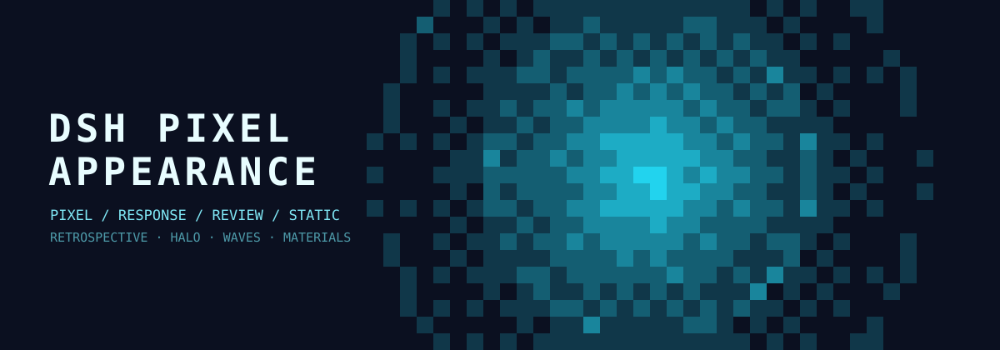

# DSH Pixel Appearance

[简体中文](README.zh-CN.md) · [English](README.md)

An appearance plugin for the **DSH (DeepSeek Harness) Web GUI**: native, pixel,
reactive, and static themes, animated pixel backgrounds, a pointer halo with a
temporal pixel trail, configurable pixel geometry, canvas materials, and
composer/sidebar materials.



The plugin is a self-contained DSH bundle: a Host half that publishes the
Host-backed settings namespace and a browser half that renders the themes. All
pictures, palettes, and code live in this repository; there is no runtime npm
dependency.

## Features

### Themes

- **Native** — keeps the stock DSH look and removes all custom layers.
- **Pixel** — a seamless animated pixel field with ripple, rain, aurora, and
  pulse generators.
- **Response** — an event-driven pixel field:
  - a round pointer halo whose centre is the main colour and which fades to the
    background colour;
  - a click wave at the pointer;
  - waves from the composer edge or the text caret while typing, deleting, or
    moving the caret;
  - waves from each new Agent message line (including streamed Markdown blocks);
  - optional breathing halo (static or dynamic);
  - optional temporal trail: main-colour pixels stamped at the pointer that fade
    back to the background over a configurable retention time;
  - wave damping to shorten and fade every wave.
- **Static** — a local or remote picture behind the main page and sidebar with
  adjustable blur and dim.

### Appearance controls

- Seven colour combinations plus custom main/background colours.
- Pixel size (6–32 CSS px), square or rounded pixels, and a corner radius that
  scales with the pixel size.
- Canvas surface material for every custom theme: frosted glass or transparent.
- Composer and sidebar materials: native, frosted glass, or transparent, each
  with colour and opacity.
- A global blur radius used by the frosted materials.
- Responsive reduced-motion behaviour.

All settings are stored in the plugin's **Host-backed Config**, shared by every
authenticated browser on the same DSH profile.

## Requirements

- DSH Desktop or a DSH Web GUI with the plugin manager.
- Node.js **20+** only if you want to rebuild `client.js` from source.
- The plugin is developed against DSH `0.2.1-rc.5`; the client half relies on a
  few stable conversation DOM attributes (see [Compatibility](#compatibility)).

## Installation

### Recommended: install through DSH's plugin manager

1. Download or clone this repository to a permanent folder, for example:

   ```text
   C:\Users\<you>\.dsh\plugins\dsh-pixel-appearance
   ```

2. In DSH, open an Agent/Creator chat and send:

   ```text
   Use plugin_manager with action "install_bundle" and target
   "<ABSOLUTE_PATH_TO_THIS_FOLDER>", then tell me when the installation is applied.
   ```

   The same operation is `plugin_manager({ action: "install_bundle", target:
   "<ABSOLUTE_PATH_TO_THIS_FOLDER>" })`.

3. **Fully quit and relaunch DSH** (do not only close the window). Host code and
   Host Config are loaded at startup.

4. Open **Settings → Appearance**. The plugin is listed as **Pixel Appearance** in
   the plugin manager, and its settings page is labeled **Appearance**.

> The bundle inserts a Host entry with id `appearance`. Disable or remove any
> other plugin that already owns that id before installing this one.

### Advanced: link the package into a profile

If you manage your profile manually, place this folder somewhere permanent and
add a dependency to the profile's `package.json`:

```json
{
  "dependencies": {
    "dsh-pixel-appearance": "link:D:/path/to/dsh-pixel-appearance"
  }
}
```

Then install the profile dependencies with pnpm and enable the bundle in the
plugin manager. This is equivalent to how local DSH plugins are linked; the
plugin files are not copied into the profile.

### Updating

Replace the folder contents with a new release, run the build if you edit the
source, then fully restart DSH. A page refresh only reloads the browser half;
changes to `index.js` (Host Config fields) always require a DSH restart.

## Usage

Open **Settings → Appearance → Theme** and choose a theme card.

- Theme cards: Native, Pixel, Response, Static.
- The **Canvas style** panel is available for all custom themes (disabled under
  Native).
- The **Pixels** panel is enabled for Pixel and Response themes.
- The **Response effect**, **Composer wave**, and **Wave damping** panels appear
  when the Response theme is selected.
- Static theme adds a **Static picture** panel.

### Response interactions

| Event | Effect |
| --- | --- |
| Pointer moves | Round pixel halo follows the pointer |
| Pointer click | Circular wave starts at the pointer |
| Typing / deleting in the composer | Wave from the composer edge, or a caret-centred circular wave |
| Caret movement | Same as above, using the current DOM Selection |
| New Agent message line | Wave from that row's edge |
| Halo trail | Main-colour pixels at the pointer fade over the retention time |

The trail strength maps to a retention time of **250–2000 ms**. A value of 0
disables the trail. Static and dynamic halo styles both support the trail.

## Settings reference

| Field | Default | Description |
| --- | --- | --- |
| `theme` | `native` | `native`, `pixel`, `response`, or `static` |
| `palette` | `auto` | `auto`, `deepsea`, `neon`, `sunset`, `forest`, `paper`, or `custom` |
| `mainColor` / `backgroundColor` | — | Custom colours for the Custom palette |
| `animation` | `ripple` | Pixel animation: `ripple`, `rain`, `aurora`, `pulse` |
| `pixelSize` | `10` | Pixel block size in CSS px (6–32) |
| `pixelStyle` | `square` | `square` or `rounded` |
| `pixelRadius` | `0.25` | Corner radius as a fraction of the pixel size (0–0.5) |
| `responseRadius` | `180` | Pointer-halo radius in CSS px (40–400) |
| `haloStyle` | `static` | `static` or `dynamic` breathing halo |
| `trailStrength` | `0` | Trail strength (0–1); 0 = no trail, 1 ≈ 2 s retention |
| `composerWaveMode` | `whole` | `whole` (composer edge) or `caret` |
| `waveDamping` | `0` | Wave damping (0–1); higher values shorten every wave |
| `canvasStyle` | `glass` | Main canvas material: `glass` or `transparent` |
| `composerStyle` / `sidebarStyle` | `glass` | `native`, `glass`, or `transparent` |
| `composerColor` / `sidebarColor` | — | Optional tint colours |
| `composerOpacity` / `sidebarOpacity` | `0.72` / `0.6` | Material opacity (0–1) |
| `blur` | `12` | Frosted-glass blur radius in px (0–40) |
| `staticImage` | — | Data URL or http(s) picture for the Static theme |
| `staticBlur` / `staticDim` | `12` / `0.2` | Static picture blur and dim |
| `nativeMode` | `system` | Native colour scheme preference |
| `haloTrail` | `0` | **Deprecated**; kept only so older stored configs validate |

## Development

`client.js` is generated from the fragments in `src/`. Do not edit it by hand.

```powershell
node src/build.mjs
node --check client.js
node --check index.js
```

`src/INTERFACE.md` documents the fragment contract, the shared factory scope,
the pixel engine API, the Host-backed Config fields, and the runtime behaviour.

### Repository layout

```text
dsh-pixel-appearance/
├─ index.js                 Host half: Config + settings registration
├─ client.js                Generated browser half (do not edit)
├─ cordis.patch.yml         DSH bundle patch (entry id: appearance)
├─ locale/                  Plugin manager metadata (zh / en)
├─ icon.svg                 Plugin icon
├─ docs/banner.svg          README artwork
├─ src/
│  ├─ 00-head.js            Loader wrapper, constants, locale dictionaries
│  ├─ 10-engine.js          Pixel field, palette ramp, dithering, painters
│  ├─ 20-store.js           Host-backed Config store and derived state
│  ├─ 30-settings.js        Settings page React tree and CSS
│  ├─ 40-runtime.js         Scene mount, theme application, materials
│  ├─ 45-response.js        Response theme event runtime and trail buffer
│  ├─ 99-tail.js            Factory return
│  ├─ build.mjs             Fragment concatenation
│  └─ INTERFACE.md          Fragment contract and engine API
├─ vendor/                  Vendored schemastery + cosmokit (MIT)
├─ .github/workflows/       Build + syntax CI
├─ CHANGELOG.md
├─ CONTRIBUTING.md
├─ THIRD_PARTY_NOTICES.md
└─ LICENSE
```

## Compatibility

- Host settings are per profile; a different DSH profile starts from defaults.
- The Response theme reads these DSH DOM attributes:
  `[data-composer-card]`, `[data-chat-flow]`, `[data-chat-anchor-key]`, and
  `[data-chat-flow-kind]`. If a DSH update changes them, update the selectors in
  `src/45-response.js`.
- Static local pictures are stored as compressed data URLs inside the profile's
  `cordis.patch.yml`; very large pictures still make the config heavy. Prefer a
  modest image or an https link.
- Remote pictures depend on the Web GUI's CSP and network access.
- On very large windows the pixel grid is capped at roughly 90,000 cells; the
  effective pixel size may be increased slightly to keep rendering smooth.
- `prefers-reduced-motion` forces the static halo, pauses the continuous loop,
  and disables the temporal trail.
- Enabling `dsh-ascii-whales` at the same time as the Pixel or Response theme
  can stack two background canvases; disable one of them.

## License

MIT. See [LICENSE](LICENSE). Vendored packages keep their own MIT licenses in
`vendor/*/LICENSE`; see [THIRD_PARTY_NOTICES.md](THIRD_PARTY_NOTICES.md).

## Acknowledgements

- DSH / DeepSeek Harness for the plugin, slot, theme, and Host-backed settings
  APIs.
- `dsh-ascii-whales` for the frosted-composer presentation pattern.
