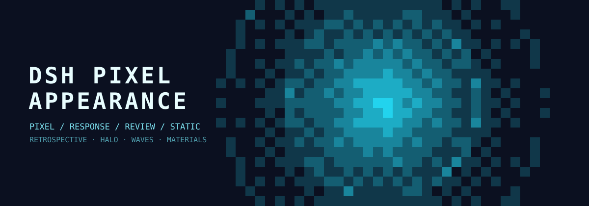

# DSH 像素外观（Pixel Appearance）

为 **DSH（DeepSeek Harness）Web GUI** 提供的外观插件：原生 / 像素 / 响应 / 静态四种主题、动态像素背景、带时间尾迹的鼠标晕影、可调像素尺寸与圆角、画布材质，以及输入卡和侧边栏材质。



插件是一个自包含的 DSH bundle：Host 半身发布 Host-backed Config 设置，浏览器半身负责主题绘制。图片、配色和代码都在本仓库内，运行时不需要额外 npm 依赖。

## 功能

### 主题

- **原生**：保留 DSH 原始外观，移除所有自绘层。
- **像素**：无缝循环的像素动画，提供涟漪、像素雨、极光波、呼吸脉冲。
- **响应**：由事件驱动的像素动画：
  - 鼠标处圆形像素晕影，中心为主体色，向外过渡到背景色；
  - 鼠标点击产生圆形扩散波；
  - 输入卡输入、删除、光标移动时，从输入卡边缘或文本光标处产生波形；
  - Agent 新消息行（含流式 Markdown 块）产生行边缘波形；
  - 晕影样式可选静态 / 动态呼吸；
  - 尾迹：在鼠标位置留下主体色像素，按设置的保留时间逐渐淡出；
  - 波形阻尼：统一缩短所有波形的扩散距离并加快衰减。
- **静态**：在主页和侧边栏下层显示本地或网络图片，可调模糊与暗化。

### 外观控制

- 7 组配色组合 + 自定义主体色/背景色。
- 像素尺寸 6–32 CSS px；方形 / 圆角像素；圆角半径按像素尺寸自动适配。
- 所有自创主题共用画布材质：毛玻璃 / 透明。
- 输入卡和侧边栏材质：原生 / 毛玻璃 / 透明，可单独设置颜色与不透明度。
- 全局模糊半径。
- 适配系统「减少动态效果」。

所有设置都保存在插件的 **Host-backed Config** 中，同一 profile 的已认证浏览器共享。

## 环境要求

- DSH Desktop 或带插件管理器的 DSH Web GUI。
- 仅在需要从源码重新生成 `client.js` 时需要 Node.js **20+**。
- 插件基于 DSH `0.2.1-rc.5` 开发；响应主题依赖少量会话 DOM 属性（见「兼容性」）。

## 安装

### 推荐：通过 DSH 插件管理器安装

1. 下载或克隆本仓库到固定目录，例如：

   ```text
   C:\Users\<你>\.dsh\plugins\dsh-pixel-appearance
   ```

2. 在 DSH 的 Agent / Creator 对话中发送：

   ```text
   请使用 plugin_manager 的 install_bundle，target 为本机绝对路径
   "<本仓库绝对路径>"，安装完成后告诉我结果。
   ```

   等价调用：`plugin_manager({ action: "install_bundle", target: "<本仓库绝对路径>" })`。

3. **完全退出并重新启动 DSH**（不能只关窗口）。Host 代码和 Host Config 在启动时加载。

4. 打开 **设置 → 外观**。插件管理器中显示为 **像素外观**，设置页标题为 **外观**。

> bundle 会插入 id 为 `appearance` 的 Host 条目。如果已有其他插件占用该 id，请先禁用或移除旧插件。

### 高级：手动以 link 方式安装到 profile

如果你手动管理 profile，可将本目录放到固定位置，并在 profile 的 `package.json` 中加入依赖：

```json
{
  "dependencies": {
    "dsh-pixel-appearance": "link:D:/path/to/dsh-pixel-appearance"
  }
}
```

然后使用 pnpm 安装 profile 依赖，并在插件管理器中启用 bundle。文件不会被复制进 profile，只是建立链接。

### 更新

用新版本内容替换目录；如果改了源码，先重新构建，然后完全重启 DSH。只刷新页面只会更新浏览器半身；`index.js` 的 Host Config 变更必须重启。

## 使用

打开 **设置 → 外观 → 主题**：

- 主题卡片：原生、像素、响应、静态。
- **画布样式**：所有自创主题可用（原生主题下禁用）。
- **像素**：像素 / 响应主题下可用。
- **响应效果 / 输入卡波形 / 波形阻尼**：选择响应主题后出现。
- **静态图片**：选择静态主题后出现。

### 响应主题交互

| 事件 | 效果 |
| --- | --- |
| 鼠标移动 | 圆形像素晕影跟随指针 |
| 鼠标点击 | 指针处产生圆形扩散波 |
| 输入卡输入 / 删除 | 从输入卡边缘产生波形，或光标模式从文本光标处产生 |
| 光标移动 | 同上，通过当前 DOM Selection 定位 |
| Agent 新消息行 | 从该行边缘产生波形 |
| 鼠标尾迹 | 在指针位置留下主体色像素，按保留时间淡出 |

**尾迹强度** 映射为 250–2000ms 保留时间；0 表示无尾迹。静态、动态晕影样式都支持尾迹。

## 设置字段

| 字段 | 默认值 | 说明 |
| --- | --- | --- |
| `theme` | `native` | `native` / `pixel` / `response` / `static` |
| `palette` | `auto` | `auto` / `deepsea` / `neon` / `sunset` / `forest` / `paper` / `custom` |
| `mainColor` / `backgroundColor` | — | 自定义配色 |
| `animation` | `ripple` | `ripple` / `rain` / `aurora` / `pulse` |
| `pixelSize` | `10` | 像素尺寸（6–32 CSS px） |
| `pixelStyle` | `square` | `square` / `rounded` |
| `pixelRadius` | `0.25` | 圆角比例（像素尺寸的 0–0.5） |
| `responseRadius` | `180` | 晕影半径（40–400 px） |
| `haloStyle` | `static` | `static` / `dynamic` |
| `trailStrength` | `0` | 尾迹强度 0–1；0 无尾迹，1 约 2 秒 |
| `composerWaveMode` | `whole` | `whole` / `caret` |
| `waveDamping` | `0` | 波形阻尼 0–1 |
| `canvasStyle` | `glass` | `glass` / `transparent` |
| `composerStyle` / `sidebarStyle` | `glass` | `native` / `glass` / `transparent` |
| `composerColor` / `sidebarColor` | — | 可选颜色 |
| `composerOpacity` / `sidebarOpacity` | `0.72` / `0.6` | 不透明度 0–1 |
| `blur` | `12` | 毛玻璃模糊半径 0–40 px |
| `staticImage` | — | 静态主题图片（data URL 或 http(s)） |
| `staticBlur` / `staticDim` | `12` / `0.2` | 图片模糊 / 暗化 |
| `nativeMode` | `system` | 原生主题明暗偏好 |
| `haloTrail` | `0` | **已废弃**，仅用于兼容旧配置 |

## 开发

`client.js` 由 `src/` 下的片段生成，不要直接编辑。

```powershell
node src/build.mjs
node --check client.js
node --check index.js
```

片段接口、像素引擎 API、Host-backed Config 与运行时行为见 [src/INTERFACE.md](src/INTERFACE.md)。

### 目录结构

```text
dsh-pixel-appearance/
├─ index.js                 Host 半身：Config + settings 注册
├─ client.js                生成的浏览器半身（不要手改）
├─ cordis.patch.yml         DSH bundle patch（条目 id：appearance）
├─ locale/                  插件管理器元数据（zh / en）
├─ icon.svg                 插件图标
├─ docs/banner.svg          README 插图
├─ src/                     生成源码片段、构建脚本、接口文档
├─ vendor/                  随包携带的 schemastery / cosmokit（MIT）
├─ .github/workflows/       构建 + 语法检查 CI
├─ CHANGELOG.md
├─ CONTRIBUTING.md
├─ THIRD_PARTY_NOTICES.md
└─ LICENSE
```

## 兼容性

- Host 设置按 profile 保存；切换 profile 不会继承。
- 响应主题读取 `[data-composer-card]`、`[data-chat-flow]`、`[data-chat-anchor-key]`、`[data-chat-flow-kind]` 等 DSH DOM 属性；DSH 更新后若变化，需要同步调整 `src/45-response.js`。
- 本地静态图片以压缩 data URL 保存在 profile 的 `cordis.patch.yml` 中，过大的图片会让配置变重；建议使用适中的图片或 https 链接。
- 远程图片能否加载取决于 Web GUI 的 CSP 与网络。
- 超大窗口下像素格数上限约 9 万，实际像素尺寸可能被自动提高以保证流畅。
- `prefers-reduced-motion` 下强制静态晕影、暂停连续循环并停用尾迹。
- 与 `dsh-ascii-whales` 同时启用时，像素 / 响应主题可能叠加两层背景画布，建议只启用一个。

## 许可证

MIT，见 [LICENSE](LICENSE)。`vendor/` 下的 schemastery / cosmokit 保留各自的 MIT 许可证，见 [THIRD_PARTY_NOTICES.md](THIRD_PARTY_NOTICES.md)。
